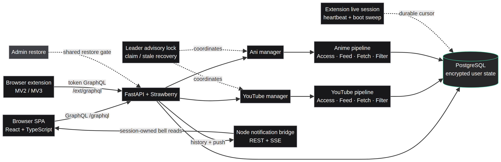
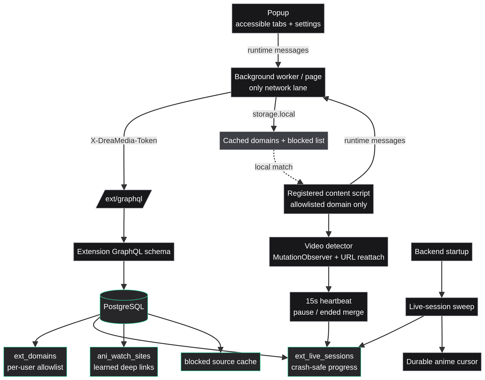

# DreaMedia Architecture

DreaMedia is a self-hosted personal media system composed of a React frontend, FastAPI/GraphQL backend, PostgreSQL database, background source workers, and browser extensions.

Compared with its HydraWatch predecessor, DreaMedia formalizes the backend around extensible media-source contracts. The architecture is intended to make a new source type a pipeline implementation rather than a cross-cutting rewrite.

## System overview



The browser and extension use separate lanes, source managers coordinate durable work, and notification history/read state live with the rest of the durable application data in PostgreSQL.

```text
                                   ┌─────────────────────┐
                                   │  External sources   │
                                   │  YouTube / AniList  │
                                   └──────────┬──────────┘
                                              │ fetch
                                              ▼
┌──────────────┐  GraphQL + REST /notifications  ┌───────────────┐
│ React browser│ ◀─────────────────────────────▶ │ FastAPI backend│
└──────────────┘                                  └──────┬────────┘
                                                        │
                                                        ▼
                                                 ┌───────────────┐
                                                 │ PostgreSQL    │
                                                 │ encrypted data│
                                                 │ + bell history│
                                                 └───────────────┘

Browser extension ── token GraphQL /ext/graphql ──▶ FastAPI
```

## Backend

### Application layer

`Backend/App` assembles FastAPI, middleware, lifespan startup, health checks, GraphQL routers, admin routes, and worker tasks.

### GraphQL

The main frontend contract is the supergraph at `/graphql`. It combines:

- authentication and viewer state;
- YouTube feed and source operations;
- categories and notification flags;
- anime entries, seasons, events, and cursors;
- personal playlists;
- trash and restore actions;
- account exports and extension settings;
- admin queries and mutations.

The extension uses a separate stable schema at `/ext/graphql` so an installed extension does not depend on internal frontend or backend refactors.

### Database

`Backend/Database` owns:

- schema creation and idempotent migrations;
- PostgreSQL connection management;
- YouTube and anime stores;
- playlist stores;
- extension stores;
- encryption and blind indexes;
- per-user vault keys;
- backup-compatible data structures.

The schema stores source identifiers and user content in a form that supports encrypted reads, equality checks, ownership, and uniqueness.

## Source orchestration

`Backend/Media` contains one folder per media (`Media/Yt`, `Media/Ani`), each mirroring the same layout. Media-specific code never lives outside the media folder:

```text
Media/<source>
├── Access        user-triggered writes/deletes (+ Fetch Now → manager)
├── Feed          user-triggered reads
├── Fetch         retrieval and metadata conversion
├── Filter        last-seen, policy, time, and user rules
├── Utility       media-specific helpers (existence checks)
├── Config
│   ├── Hardcoded media policy numbers (never .env)
│   └── Model     media pydantic models
├── SQL
│   ├── user      queries that run only when the user triggers
│   └── process   queries the backend mechanism runs (+ create.py)
├── manager.py    scheduling, claims, wake-ups, and recovery
└── pipeline.py   one refresh from fetch through feed persistence
```

The trigger boundary is the directory itself: `Feed`/`Access` run only on user trigger via GraphQL; `manager.py`/`pipeline.py`/`SQL/process` run only from the backend's own mechanism. Cross-media concerns (pool, crypto, vault, leadership, schema bootstrap, admin SQL, backup processes) live in `Database/` at the backend root; the shared fetch contract lives in `Model/`. Feed is pull-driven from the media tables; the bell receives backend-driven alerts on unhappy paths only.

### YouTube pipeline

The YouTube side includes:

- source resolution;
- RSS feed access;
- playlist access;
- random selection;
- last-seen filtering;
- WordScan filtering;
- time and rank scheduling;
- notification production;
- crash-safe work claiming.

### Anime pipeline

The anime side includes:

- AniList metadata access;
- season-chain state;
- airing and sequel scheduling;
- release and change events;
- watched-season state;
- notification production;
- next-season decisions.

Workers are responsible for fetching and state transitions. The UI expresses intent through mutations and renders the backend’s resulting state.

## Fault tolerance

Fault tolerance is treated as a product property rather than only an infrastructure concern. DreaMedia separates failure domains so one weak dependency does not erase user intent:

- source work is claimed to avoid duplicate workers;
- stale claims can be recovered after crashes;
- last-seen anchors prevent repeated or lost feed windows;
- links are stored before background metadata enrichment;
- extension heartbeats use live sessions before merging into durable cursors;
- notification production and browser delivery use separate lanes;
- the restore gate pauses writers and workers consistently;
- restore creates a pre-restore snapshot and attempts rollback;
- encrypted persistence protects data at rest while the vault is available;
- external provider failure is isolated from the user’s existing library.

This is a significant architectural step beyond a single-purpose subscription dashboard. The system can be extended without giving up recovery, ownership checks, durable state, or notification semantics.

### Local appliance fault model

The target environment is not an always-on cloud service. A DreaMedia installation may be a Docker Compose stack on a home server, workstation, NAS, or other local device. The orchestration therefore treats process shutdown, host restarts, internet loss, provider failure, and maintenance windows as normal operating conditions.

When a manager claims a due item, the claim records both working state and claim time. A crash or forced process termination can leave that record behind, so startup and manager cycles release stale claims. Release is token-aware: a late worker from an older attempt cannot clear a newer worker’s claim. Managers use PostgreSQL advisory locks to coordinate leadership, and those locks disappear with a dead database connection, allowing a surviving process to take over.

Connectivity loss is handled as a waitable condition rather than as proof that a source is empty. Provider errors schedule later work with backoff. Existing last-seen anchors and library state remain intact when a fetch or metadata enrichment fails. During restore, a database-backed gate makes workers and writers observe the same maintenance boundary. On application startup, leftover extension live sessions are swept into durable progress so an unclean browser or backend shutdown has a recovery path.

### HydraWatch and DreaMedia orchestration

HydraWatch established the product philosophy with a focused chronological feed. Its orchestration is a simpler content-server model: a timer examines each SQLite database, selects the earliest due channel, invokes fetch-and-process work, handles SQLite locks, and backs off after errors. That model is appropriate for its narrower scope and remains an important part of the lineage.

DreaMedia keeps the same source-respecting goal but formalizes orchestration per media type. YouTube and anime each have a manager and pipeline, with atomic database claims, stale-claim recovery, token-matched release, advisory-lock leadership, event-driven wake-up for immediate fetches, connectivity waiting, provider backoff, graceful cancellation, restore awareness, and durable state transitions. The result is not merely more features around the old timer. It is a reusable source architecture in which adding a new media type also means defining how that source claims, runs, pauses, retries, resumes, and recovers.

The distinction matters at the local-device boundary. HydraWatch’s loop mainly protects a scheduled SQLite process from ordinary errors. DreaMedia’s orchestration protects a multi-source PostgreSQL application from interrupted work, competing processes, dead leaders, offline periods, restore activity, and partial browser progress while preserving the user’s intent.

## Notification model

DreaMedia intentionally separates two notification lanes:

### Feed lane

YouTube videos and anime events are read through the main GraphQL workspace query. Seen state and trash state belong to the feed model.

### Bell lane

Backend-originated messages such as release confirmations and operational events are written once to the encrypted PostgreSQL `notifications` table. The frontend bell reads that table through the authenticated FastAPI `/notifications` API and updates `seen` state through `/notifications/seen`. The bell polls the API; there is no separate JSON inbox, notification service, or second source of truth.

Ordinary YouTube and anime feed rows remain in their own feed tables and do not silently appear in the bell. Bell notification content, ownership, and read state all remain in PostgreSQL.

## Notification scope gate

A notification is delivered only when the relevant scope permits it:

```text
domain.notify
AND subdomain.notify
AND source.notify
AND label = none
AND source/entry is active
```

A parent mute changes effective delivery without rewriting child preferences.

## Encryption and vault

User content is encrypted with an authenticated encryption scheme. A user key is derived at login from the password and username and held in the process vault. The database stores ciphertext and blind indexes where equality checks are necessary.

The vault is intentionally tied to an authenticated session lifecycle. Logging out, revoking sessions, or restoring a database can drop the in-memory key.

## Frontend

`Frontend/src` is a React 19 TypeScript SPA.

Major feature areas:

- auth;
- notifications;
- management;
- anime;
- categories;
- Todo;
- trash;
- bell;
- settings;
- extension settings;
- admin.

The frontend uses a workspace read model and a shared mutation helper that refetches after writes. This favors correctness and visible server state over complex optimistic-cache behavior.

## Browser extension



The extension diagram shows the current privacy boundary: content scripts run only on user-allowlisted domains, the background worker owns network access, and live playback state is recoverable through the backend’s durable session sweep.

The extension uses a background worker as its only network lane.

```text
Content script / popup
          │ runtime messages
          ▼
Background worker
          │ token-authenticated HTTP or WebSocket
          ▼
DreaMedia /ext/graphql
```

The extension supports separate modules for YouTube and anime sites. Site registration is allowlisted, and the extension token is independent of the web session cookie.

Anime progress uses a live-session path so frequent heartbeats do not directly overwrite the durable cursor. A pause or ended event merges final position into the real cursor.

## Administration and restore

Backups use PostgreSQL dump tooling. Restore uploads are staged and validated with `pg_restore -l` before being accepted. A restore job:

1. closes the restore gate;
2. creates a pre-restore snapshot;
3. pauses writers and workers;
4. runs the destructive restore;
5. attempts rollback if restore fails;
6. drops sessions after a successful restore;
7. reopens the gate and exposes tracked status.

## Deployment

Docker Compose runs:

- `db` — PostgreSQL;
- `backend` — FastAPI and workers;
- `frontend` — Nginx/Vite-served application.

The local development launcher can run the backend and frontend outside containers while retaining Docker PostgreSQL. The bell reads notification history and persists read state through the authenticated backend API; both remain in the dedicated PostgreSQL notifications table.

## Design tradeoffs

- One workspace query makes the SPA simple but creates a scaling pressure toward pagination.
- PostgreSQL is the sole durable source of truth for notification history and read state; the frontend does not maintain a separate notification inbox.
- The anime cursor is simple and useful but is not a complete rewatch history model.
- External metadata providers improve UX but introduce availability and freshness dependencies.
- Self-hosting gives control but makes host, backup, TLS, and filesystem security the user’s responsibility.
