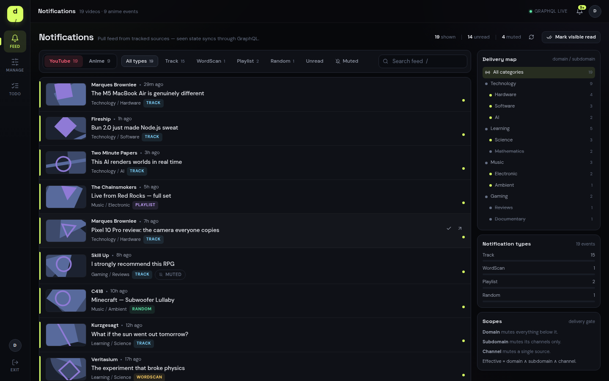
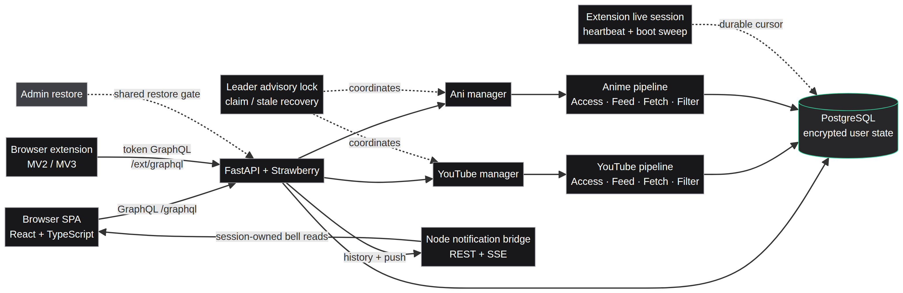

# DreaMedia

## Own your media relationship

DreaMedia is a self-hosted media command center for everything you follow, watch, and intend to watch.

It brings YouTube sources, anime releases, notifications, watch progress, personal playlists, browser-based tracking, and backups into one private workspace — without requiring a Google account to remember your subscriptions or watch history.

> **Escape the algorithm without abandoning the creator.**
>
> Follow the sources you deliberately choose, decide what deserves your attention, and keep your media memory under your control.



## Why DreaMedia exists

Modern media platforms are very good at making content convenient. They are also very good at making the platform itself the owner of your attention:

- subscriptions belong to an account on the platform;
- recommendations decide what appears next;
- watch history becomes behavioral data;
- notifications are optimized for engagement;
- progress is fragmented across websites and devices;
- leaving the platform often means losing continuity.

DreaMedia takes a different approach. It does not try to become another video platform, proxy creator content, or replace the original source. DreaMedia keeps the relationship between you and the sources you follow in your own system. When you choose to watch, you can still open the canonical creator or platform link.

This gives you the convenience of a personal media account without requiring your media life to belong to a platform.

## From HydraWatch to DreaMedia

DreaMedia is the successor to [HydraWatch](https://github.com/rigen1048/HydraWatch), which began with a focused question:

> Can you escape YouTube's algorithm and account dependency without abandoning the creators you actually want to follow?

HydraWatch answered with a chronological, channel-based feed built around official YouTube RSS sources, free-form categories, conservative polling, CSV migration, and a local-first privacy model. DreaMedia carries that foundation forward and expands it into a broader personal media system:

```text
HydraWatch:
  Follow channels → organize them → receive a clean chronological feed

DreaMedia:
  Follow sources → define attention rules → track releases
  → remember progress → maintain personal queues → continue anywhere
```

The philosophy remains creator-respecting. DreaMedia does not try to become an unofficial copy of YouTube or replace the original platform with another opaque intermediary. It fetches source information through supported mechanisms and opens canonical links when you choose to watch.

HydraWatch users can bring existing subscriptions into DreaMedia through CSV migration. See the [HydraWatch feature overview](https://github.com/rigen1048/HydraWatch/blob/main/FEATURES.md) for the predecessor’s original category-first and algorithm-free design.

## More than a successor: a fault-tolerant media platform

DreaMedia is not only a larger HydraWatch. It formalizes the backend around media-source boundaries so new source types can be added without rewriting the whole application.

Each media pipeline has explicit seams for access, feed modeling, fetching, filtering, orchestration, persistence, and notifications. YouTube and anime are different implementations of a broader media-handling architecture rather than two unrelated features glued into one UI.

That structure makes the system more extensible for contributors and more fault-tolerant for users. Source workers claim work safely, recover stale work, preserve last-seen state, separate backend notification production from browser delivery, and keep restore operations behind a shared gate. Metadata enrichment can fail without losing the user’s original link or intent, and extension progress uses a live-session path so frequent heartbeats do not corrupt the durable cursor.

The result is a system designed to grow:

```text
Media source
├── Access        resolve and communicate with the source
├── Feed          represent source events
├── Fetch         retrieve new source data
├── Filter        apply user and source policy
├── Pipeline      coordinate one refresh
├── Manager       schedule and recover work
└── Notify        deliver durable user-facing events
```

This is the architectural difference between a focused application and an extensible personal media platform.

### Fault-tolerant local appliance, not just a Docker deployment

DreaMedia’s reliability model is aimed at the conditions of a real local appliance: a small server or desktop that may be restarted, lose connectivity, run for weeks, or be interrupted while background work is in progress. Docker makes the system convenient to package; it is not the whole fault-tolerance story.

If a process is killed during a fetch, the database claim is not treated as permanent ownership. On the next cycle, stale work can be released and claimed again. If the host restarts after an unclean shutdown, durable last-seen anchors let source pipelines resume without assuming that the previous process finished. PostgreSQL advisory locks also release with a dead connection, so another backend process can become the active manager instead of waiting for a vanished leader.

The same model covers less dramatic but common conditions: when the internet is unavailable for hours or days, pipelines wait and retry rather than interpreting the outage as an empty source; when a provider is rate-limited or temporarily unavailable, backoff prevents a tight retry storm and preserves existing user state; when multiple backend processes are present, atomic claims prevent duplicate work; and while a restore is active, the shared restore gate keeps workers from writing into a database being replaced.

The browser side follows the same principle. Extension playback heartbeats use a live-session path and are merged into the durable cursor at meaningful transitions, so a browser or extension crash does not turn every heartbeat into a fragile permanent write. This is why DreaMedia’s fault tolerance is part of the product experience: a local installation can lose a process, a network, or a browser session without losing the user’s media relationship.

## What DreaMedia brings together

- A chronological, source-driven media feed.
- Track, WordScan, Playlist, and Random notification modes.
- Domain → subdomain → channel/anime attention scopes.
- Anime release, sequel, season, and airing-state tracking.
- S/E/time watch cursors and a unified anime queue.
- Personal video playlists with background metadata enrichment.
- Browser-extension watch tracking and subscribe-from-page workflows.
- Learned watch sites and release deep links.
- Trash-and-restore for opened notifications.
- Portable exports, CSV migration, encrypted storage, and database backups.
- Admin restore, user management, and operational controls.

Read the detailed breakdown in [FEATURES.md](FEATURES.md).

## Privacy and independence

DreaMedia is built for users who want a hardened browser, VPN, cookie resistance, and platform independence without giving up everyday UX.

Your DreaMedia instance can remember subscriptions, categories, notification rules, queues, and progress while the browser remains signed out of Google and external platforms. User content is encrypted at rest, extension access uses a separate revocable token, and the personal media graph stays in the user-controlled instance.

Self-hosting does not remove the need for security. It gives the user a clearer boundary and control over where that responsibility lives. Read [PRIVACY.md](PRIVACY.md) for the threat model and deployment guidance.

## Quick start

See [INSTALL.md](INSTALL.md) for the full guide.

```bash
cp .env.example .env
# Set DREAMEDIA_PG_PASSWORD in .env
python3 setup.py
```

Open `http://localhost:8124`. The first registered account becomes an administrator.

> **Data lifecycle:** the current launcher performs a backup and clean rebuild before starting the application. Keep backups available and review the launcher behavior before using it on valuable data. A future safe-start workflow should preserve an existing database volume by default.

## Architecture at a glance



The diagram is generated from the current backend, bridge, database, manager, and extension boundaries. The extension-specific lanes are shown in [ARCHITECTURE.md](ARCHITECTURE.md#browser-extension).


```text
Browser ── GraphQL /graphql ──▶ FastAPI ──▶ PostgreSQL
   ▲                              │
   └──── REST + SSE /bridge ◀─────┘
                    notification bridge
```

- **Backend:** FastAPI, Strawberry GraphQL, PostgreSQL, background workers.
- **Frontend:** React 19, TypeScript, Vite, Radix UI primitives.
- **Bridge:** small Node.js REST + SSE receiver for backend-originated bell messages.
- **Extension:** Chrome MV3 and Firefox MV2 with a stable extension GraphQL lane.
- **Deployment:** Docker Compose or local development mode.

See [ARCHITECTURE.md](ARCHITECTURE.md).

## Documentation

- [FEATURES.md](FEATURES.md) — complete feature inventory and user workflows.
- [INSTALL.md](INSTALL.md) — installation, configuration, extension setup, demo data, upgrades, and troubleshooting.
- [PRIVACY.md](PRIVACY.md) — privacy model, trust boundaries, and hardening guidance.
- [ARCHITECTURE.md](ARCHITECTURE.md) — system design, data flow, and major components.
- [CONTRIBUTING.md](CONTRIBUTING.md) — contribution philosophy, development setup, and testing.
- [Extension README](Extension/README.md) — browser-extension setup.
- [Frontend UX specification](docs/frontend_ux.md) — detailed interface behavior.

## License

DreaMedia is licensed under the [GNU Affero General Public License v3.0](LICENSE).
