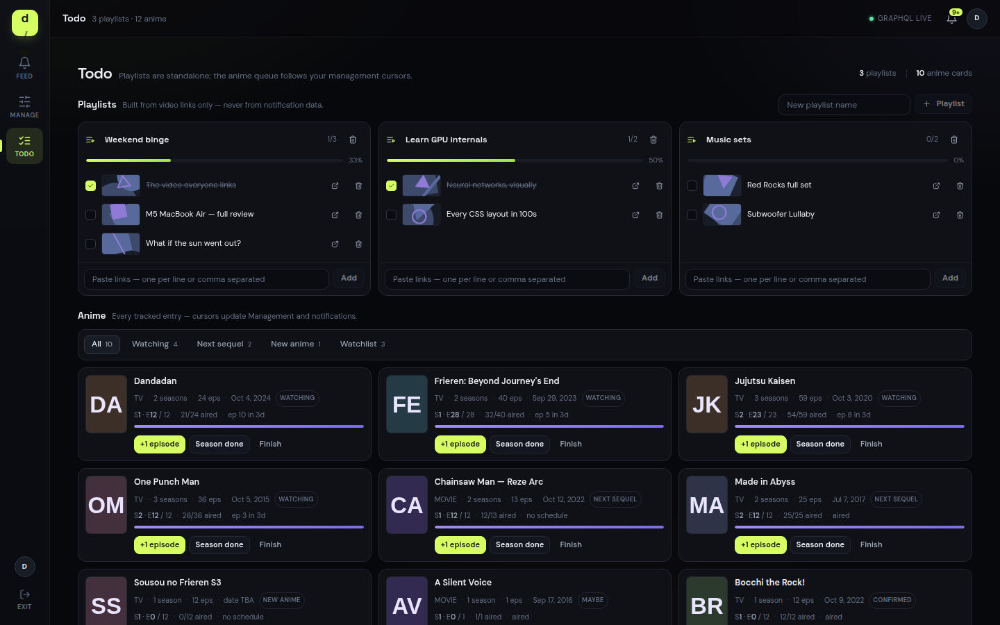

# DreaMedia

A self-hosted console for everything you follow: YouTube sources and anime
releases, with notification control that reaches all the way down to a single
channel and a todo lane that keeps up with your watch cursors.

```text
DreaMedia/
├── Backend/            FastAPI · Strawberry GraphQL · Postgres · workers
├── Frontend/           React 19 · TypeScript · Vite · the notification receiver
│   └── server/         notify-bridge.mjs (frontend-owned REST + SSE inbox)
├── compose.yaml        db · backend · bridge · frontend
├── start.py            one-command launcher (docker stack, or --dev local)
└── README.md
```

## Architecture in one screen

**One API for data, one receiver for messages.**

- The frontend talks to the backend through **a single GraphQL endpoint**
  (`POST /graphql`) for every read and write: auth, YouTube feed and channels,
  domain/subdomain CRUD, notification switches, anime metadata and cursors,
  playlists and backend message history.
- The backend pushes bell messages to a **REST receiver the frontend owns**
  (`Frontend/server/notify-bridge.mjs`, reached through the frontend's `/bridge`
  proxy). The bell reads list + SSE only from that receiver, so feed rows can
  never appear in the bell.
- The receiver is deliberately narrow: its push endpoint is valid only with the
  shared token on the internal compose network, the browser-facing proxy
  refuses pushes, and reads require the caller's real session (the bridge asks
  `/auth/session` who owns the cookie), so a guessed `userId` reads nothing.
- Notification delivery is gated by `domain.notify AND subdomain.notify AND
  channel/entry.notify AND label = 'none'`. Muting a domain silences every
  channel beneath it without touching their individual flags.
- Everything is encrypted at rest; per-user keys derive from the password at
  login and live only in the process vault. Sessions are cookies, so the
  backend keeps them in memory — a restart asks you to sign in again.

```text
browser ──GraphQL /graphql──────────────▶ FastAPI ──▶ Postgres
   ▲                                        │
   └──REST + SSE /bridge ◀── POST push ─────┘  (notify() history lane + push lane)
```

## A look

| Notifications | Management · channels |
| --- | --- |
|  |  |
| **Management · anime** | **Todo** |
|  |  |

Categories and the bell: [`docs/screenshots`](docs/screenshots).

## Quick start

Requirements: Docker Compose v2 for the default stack. For `--dev` you also
need `uv`, `bun` and Node 20+.

```bash
cp .env.example .env      # set DREAMEDIA_PG_PASSWORD
python3 start.py          # docker stack: db, backend, bridge, frontend
python3 start.py --fresh  # same, but start from an empty database
# or run the pieces locally (uv + bun + node):
python3 start.py --dev
```

`start.py` backs up Postgres (and validates the dump), tears the stack down,
rebuilds it, restores the newest dump and waits until `:3000` actually answers
before printing the URLs — it exits non-zero instead of leaving you with a
half-started stack. Bell history lives in `./.bridge` and survives the wipe.

Open <http://localhost:3000>. Health: app `:3000/health`, bridge
`:3000/bridge/health` (the receiver has no published port by design).
On a fresh database the first screen is **Sign up** — that account becomes
admin. Signed-in sessions are in memory, so a backend restart asks you to log
in again.

### Demo data

```bash
# docker stack
docker compose exec backend python scripts/seed_demo.py

# local dev
cd Backend && DREAMEDIA_PG_PASSWORD=... .venv/bin/python scripts/seed_demo.py
```

The seed creates `demo / demo1234` and pushes three bell messages through the
real receiver, so the bell is exercised end to end.

Eleven YouTube channels across five domains (one muted domain, one muted
subdomain, one muted channel, one blocked channel), three playlists, twelve
anime entries with seasons, events and metadata.

## Configuration (root `.env`)

| Variable | Purpose |
| --- | --- |
| `DREAMEDIA_PG_PASSWORD` | required, shared by Compose and the app |
| `DREAMEDIA_PG_DSN` | optional full DSN override |
| `DREAMEDIA_PG_HOST` / `_PORT` | database address (compose sets `db`; defaults to `127.0.0.1:5432`) |
| `ACCESS` | `computer` (localhost) or `wifi` (LAN bind) |
| `FRONTEND_NOTIFY_URL` | backend → receiver URL (launcher sets it) |
| `FRONTEND_NOTIFY_TOKEN` | optional shared secret, sent as `X-Dreamedia-Token` |
| `BRIDGE_PORT` / `BRIDGE_STORE` | receiver port (3100, internal) and inbox file |
| `BRIDGE_BACKEND_URL` | where the receiver validates sessions (`http://backend:8000`) |
| `BACKUP_DIR`, `BACKUP_KEEP_LATEST` | backup policy seeds |

Policy values (ranks, floors, cooldowns) stay hardcoded in
`Backend/Config/Hardcoded/`.

## What the app does

**Notifications** — one dense feed with YouTube (Track, WordScan, Random,
Playlist) and Anime (release & change: today, sequel, new) events, scope rail,
type counters and seen-state. The bell covers backend messages only and opens
`/bridge` messages with a live delivery indicator.

**Management** — channels table with inline editors (type, WordScan terms,
random frequency, category attach, notify switch, pause/block, delete), category
cards for domains and subdomains (create, rename, delete, mute at any level),
anime cards with metadata (type, seasons, episodes, release, `S`/`E`, progress,
airing countdown) plus list buckets, watchlist certainty, notify switches and
per-season state, and a blocked/cleanup lane.

**Todo** — standalone playlists built from pasted video links (multiple named
cards, progress, check-off, item removal; links are stored instantly and
metadata is enriched in the background) and an anime queue driven by the same
cursors as Management (`+1 episode`, season done, finish) with next-airing
context.

Keyboard: `1` `2` `3` switch modes, `/` searches, `Esc` closes panels.

## Repository map

| Path | Notes |
| --- | --- |
| `Backend/App` | FastAPI app, routers, cookie middleware |
| `Backend/Graphql` | the single schema (`children.py`, `supergraph.py`) |
| `Backend/Database` | schema.sql (idempotent migrations), stores, vault/crypto |
| `Backend/Orchestrator` | YouTube and Ani pipelines, filters, schedulers |
| `Backend/Utility/notify.py` | history lane + receiver push + scope gates |
| `Frontend/src/app` | shell, GraphQL client, provider, UI primitives |
| `Frontend/src/features` | notifications, management, todo, bell, auth |
| `Frontend/server/notify-bridge.mjs` | REST receiver, SSE, JSON inbox |

## Checks

```bash
# from the repo root, against the running stack
python3 e2e.py             # 18 browser checks over the real UI

# unit/integration
cd Backend && DREAMEDIA_PG_PASSWORD=... .venv/bin/python -m pytest -q
cd ../Frontend && npm run check && npm run build
```
