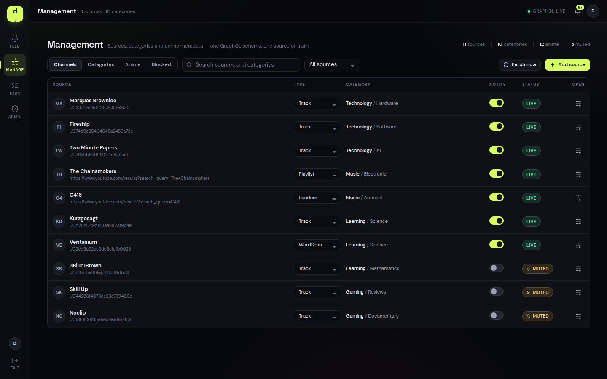
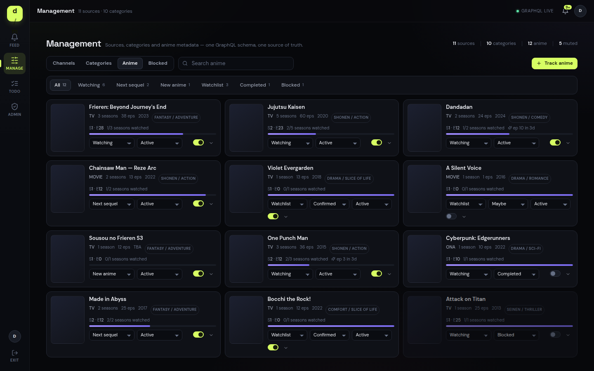
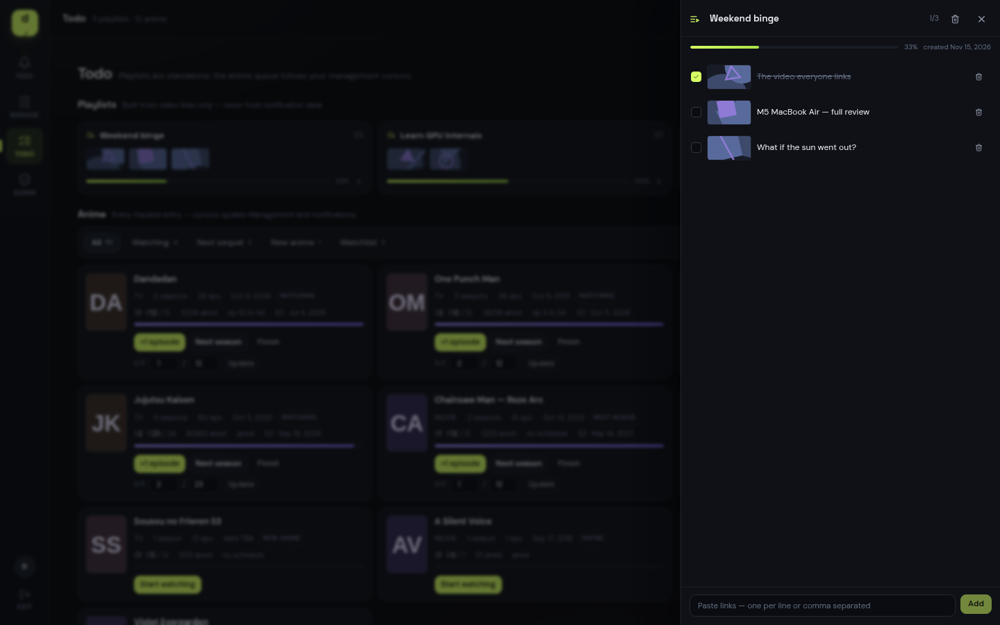
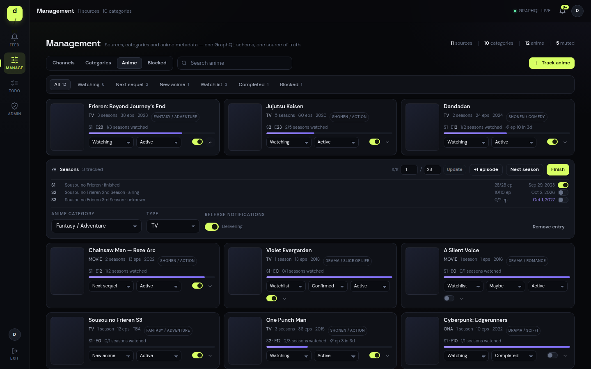
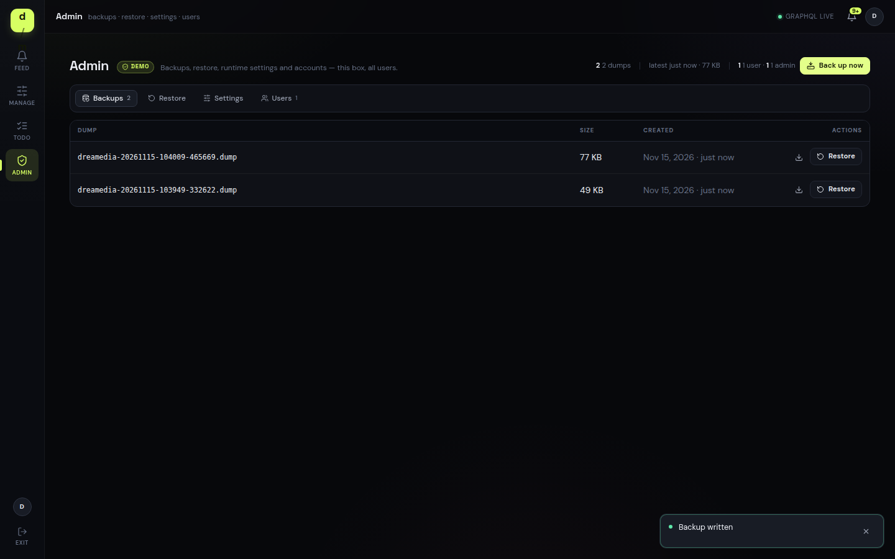
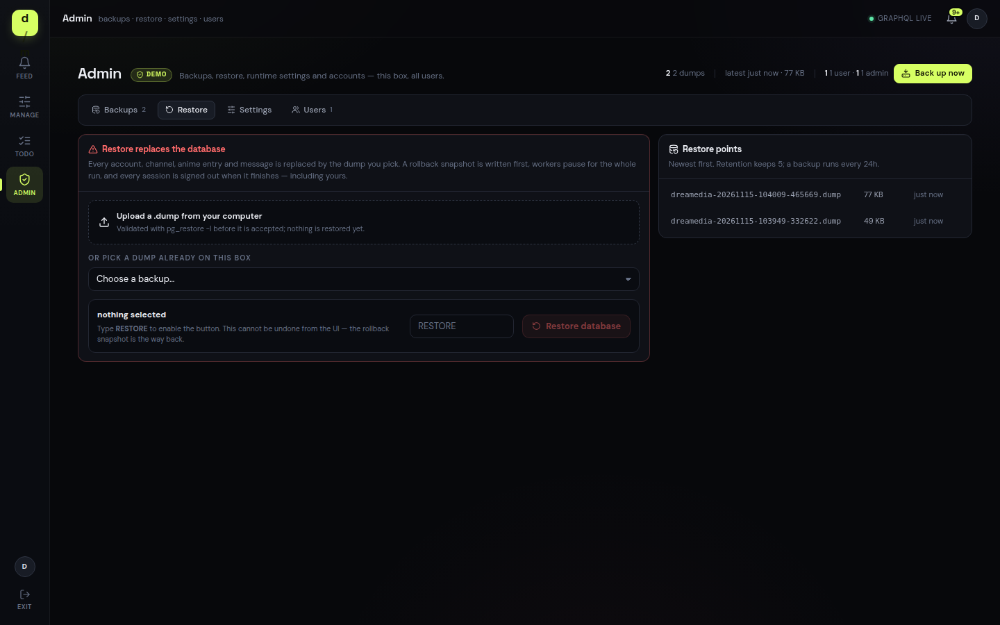

# DreaMedia

A self-hosted console for everything you follow: YouTube sources and anime
releases, with notification control that reaches all the way down to a single
channel and a todo lane that keeps up with your watch cursors.

```text
DreaMedia/
├── Backend/            FastAPI · Strawberry GraphQL · Postgres · workers
├── Frontend/           React 19 · TypeScript · Vite · the notification receiver
│   └── server/         notify-bridge.mjs (frontend-owned REST + SSE inbox)
├── compose.yaml        db · backend · bridge · frontend
├── start.py            one-command launcher (docker stack, or --dev local)
└── README.md
```

## Architecture in one screen

**One API for data, one receiver for messages.**

- The frontend talks to the backend through **a single GraphQL endpoint**
  (`POST /graphql`) for every read and write: auth, YouTube feed and channels,
  domain/subdomain CRUD, notification switches, anime metadata and cursors,
  playlists and backend message history.
- The backend pushes bell messages to a **REST receiver the frontend owns**
  (`Frontend/server/notify-bridge.mjs`, reached through the frontend's `/bridge`
  proxy). The bell reads list + SSE only from that receiver, so feed rows can
  never appear in the bell.
- The receiver is deliberately narrow: its push endpoint is valid only with the
  shared token on the internal compose network, the browser-facing proxy
  refuses pushes, and reads require the caller's real session (the bridge asks
  `/auth/session` who owns the cookie), so a guessed `userId` reads nothing.
- Notification delivery is gated by `domain.notify AND subdomain.notify AND
  channel/entry.notify AND label = 'none'`. Muting a domain silences every
  channel beneath it without touching their individual flags.
- Everything is encrypted at rest; per-user keys derive from the password at
  login and live only in the process vault. Sessions are cookies, so the
  backend keeps them in memory — a restart asks you to sign in again.

```text
browser ──GraphQL /graphql──────────────▶ FastAPI ──▶ Postgres
   ▲                                        │
   └──REST + SSE /bridge ◀── POST push ─────┘  (notify() history lane + push lane)
```

## A look

| Notifications | Management · channels |
| --- | --- |
|  |  |
| **Management · anime** | **Todo** |
|  |  |
| **Todo · playlist drawer** | **Management · anime detail** |
|  |  |
| **Admin · backups** | **Admin · restore** |
|  |  |

Categories and the bell: [`docs/screenshots`](docs/screenshots).

## Quick start

Requirements: Docker Compose v2 for the default stack. For `--dev` you also
need `uv`, `bun` and Node 20+.

```bash
cp .env.example .env      # set DREAMEDIA_PG_PASSWORD
python3 start.py          # docker stack: db, backend, bridge, frontend
python3 start.py --fresh  # same, but start from an empty database
# or run the pieces locally (uv + bun + node):
python3 start.py --dev
```

`start.py` backs up Postgres (and validates the dump), tears the stack down,
rebuilds it, restores the newest dump and waits until `:3000` actually answers
before printing the URLs — it exits non-zero instead of leaving you with a
half-started stack. Bell history lives in `./.bridge` and survives the wipe.

Open <http://localhost:3000>. Health: app `:3000/health`, bridge
`:3000/bridge/health` (the receiver has no published port by design).
On a fresh database the first screen is **Sign up** — that account becomes
admin. Signed-in sessions are in memory, so a backend restart asks you to log
in again.

### Demo data

```bash
# docker stack
docker compose exec backend python scripts/seed_demo.py

# local dev
cd Backend && DREAMEDIA_PG_PASSWORD=... .venv/bin/python scripts/seed_demo.py
```

The seed creates `demo / demo1234` and pushes three bell messages through the
real receiver, so the bell is exercised end to end.

Eleven YouTube channels across five domains (one muted domain, one muted
subdomain, one muted channel, one blocked channel), three playlists, twelve
anime entries with seasons, events and metadata.

## Configuration (root `.env`)

| Variable | Purpose |
| --- | --- |
| `DREAMEDIA_PG_PASSWORD` | required, shared by Compose and the app |
| `DREAMEDIA_PG_DSN` | optional full DSN override |
| `DREAMEDIA_PG_HOST` / `_PORT` | database address (compose sets `db`; defaults to `127.0.0.1:5432`) |
| `ACCESS` | `computer` (localhost) or `wifi` (LAN bind) |
| `FRONTEND_NOTIFY_URL` | backend → receiver URL (launcher sets it) |
| `FRONTEND_NOTIFY_TOKEN` | optional shared secret, sent as `X-Dreamedia-Token` |
| `BRIDGE_PORT` / `BRIDGE_STORE` | receiver port (3100, internal) and inbox file |
| `BRIDGE_BACKEND_URL` | where the receiver validates sessions (`http://backend:8000`) |
| `BACKUP_DIR`, `BACKUP_KEEP_LATEST` | backup policy seeds |

Policy values (ranks, floors, cooldowns) stay hardcoded in
`Backend/Config/Hardcoded/`.

## What the app does

**Notifications** — one dense feed with YouTube (Track, WordScan, Random,
Playlist) and Anime (release & change: today, sequel, new) events, scope rail,
type counters and seen-state. The bell covers backend messages only and opens
`/bridge` messages with a live delivery indicator.

**Management** — channels table with inline editors (type, WordScan terms,
random frequency, category attach, notify switch, pause/block, delete) and a
**Fetch now** button that makes every active source due immediately and wakes
the manager, so a freshly added channel shows its videos without waiting for
the next poll. Category cards for domains and subdomains (create, rename,
delete, mute at any level), anime cards with metadata (type, seasons, episodes,
release, `S`/`E`, progress, airing countdown) plus list buckets, watchlist
certainty, notify switches and per-season state (with each season's date), and
a blocked/cleanup lane.

Tracking an anime asks where you are: **just starting**, **on S*n* E*m***, or
**finished *n* seasons**. For the last one the backend decides by itself
whether the next season is already out — it jumps there and puts the entry back
in Watching — or is still scheduled, in which case the entry waits in Next
sequel with the announced date and a bell message when it airs. The same
**Next season** button on any card (Management or Todo) does that bump later.
Bumps are forward-only on purpose, so overshooting needs a way back: every
expanded anime card (and each Todo queue card) carries a small **S/E** editor
that sets the cursor anywhere — backwards included — and re-derives which
seasons count as watched from the new position.

**Todo** — standalone playlists built from pasted video links (multiple named
cards; links are stored instantly and metadata is enriched in the background).
The grid holds compact tiles (name, progress, three thumbnails); clicking one
slides the full list in from the right in a drawer — thumbnail + title per row,
each row the link to the video, check-off, delete and the add box. Nothing
grows with playlist length, and the drawer closes on Escape or a click
outside. The anime queue below is driven by the same cursors as Management
(`+1 episode`, `Next season`, finish) with next-airing and next-season dates.

**Admin** (admin role only, fourth rail item) — backups with sizes and ages
(take one now, download, pick one to restore), a restore panel that accepts an
uploaded `.dump` from any machine, runtime settings with their hardcoded
floors, and user management (promote/demote, reset password, delete). Restore
is a tracked background job with progress, a pre-restore snapshot, and a
forced sign-out for everyone when it finishes.

Keyboard: `1` `2` `3` switch modes (`4` opens Admin for admins), `/` searches,
`Esc` closes panels.

## Repository map

| Path | Notes |
| --- | --- |
| `Backend/App` | FastAPI app, routers, cookie middleware |
| `Backend/Graphql` | the single schema (`children.py`, `supergraph.py`) |
| `Backend/Database` | schema.sql (idempotent migrations), stores, vault/crypto |
| `Backend/Orchestrator` | YouTube and Ani pipelines, filters, schedulers |
| `Backend/Utility/notify.py` | history lane + receiver push + scope gates |
| `Backend/Admin` | settings, backup, restore (tracked), users/roles |
| `Backend/Graphql/admin.py` | admin queries/mutations on the same schema |
| `Frontend/src/app` | shell, GraphQL client, provider, UI primitives |
| `Frontend/src/features` | notifications, management, todo, bell, auth, admin |
| `Frontend/server/notify-bridge.mjs` | REST receiver, SSE, JSON inbox |
| `qa/` | browser checks (`e2e.py`) and screenshot capture (`shots.py`) |

## Admin and recovery

The first account to sign up becomes admin; the rail grows a fourth item for
that role. The page is a normal part of the app and speaks the same GraphQL
schema as everything else — with three deliberate REST exceptions:

| Operation | Why it is not GraphQL |
| --- | --- |
| `POST /admin/restore/upload` | multipart file upload |
| `GET /admin/backups/{file}` | binary download of a dump |
| `GET /admin/restore/status` | must answer *while* a restore runs, and the middleware 503s every mutation during one |

Everything else (settings, backup list, run backup, start restore, users,
roles, password resets) is GraphQL under `admin*` fields, and each resolver
re-checks the role against the database — the hidden nav item is convenience,
not authorisation.

**Restoring replaces the database for every user.** The flow is deliberately
boring: the dump is validated with `pg_restore -l` before it is accepted, the
restore writes a rollback snapshot first, workers pause for the whole window,
the API refuses mutations with 503, and on success every session is dropped
(including the admin who started it) so nobody keeps a cookie minted against
the old data. If `pg_restore` fails, the snapshot is restored automatically.
You must type `RESTORE` to arm the button.

Locked out with no admin account (restored old dump, deleted the account,
forgot which signup was first)? The page cannot help — that is the one case
that needs the shell:

```bash
docker compose exec backend python -m scripts.admin list
docker compose exec backend python -m scripts.admin promote <username>
```

`scripts/seed_demo.py` promotes the demo account to admin so the demo box can
show the page.

## Checks

```bash
# 39 browser checks against the running stack (real UI, real GraphQL),
# including a real backup → upload → destructive restore round-trip
python3 qa/e2e.py
python3 qa/shots.py        # regenerate the screenshots in docs/screenshots

# 74 backend tests: units, API/GraphQL integration, black-box scenarios, admin
cd Backend && DREAMEDIA_PG_PASSWORD=... .venv/bin/python -m pytest -q
cd ../Frontend && npm run check && npm run build
```

`Backend/tests/test_scenarios.py` is the black-box lane: it drives the real
app over HTTP/GraphQL (cookies, Postgres, scheduler tick) and fakes only the
two upstreams it cannot own — the YouTube RSS feed and AniList — so the
pipeline itself runs unmodified. It covers, among others:

| Case | What it proves |
| --- | --- |
| YT last-seen anchor | A channel whose last-seen video is the 3rd newest yields exactly two messages; the next upload produces only the new one |
| WordScan | Keyword filtering fires on matching titles only, and the anchor still advances past non-matching uploads |
| Mute scope | A muted channel stores the video but sends no message; a muted domain silences it without rewriting the channel flag |
| Anime release day | Same release date + same episode count on Friday morning ⇒ `release_confirmed`, filed under **Today**, no duplicate |
| Anime date moved | Release date changed ⇒ `release_changed` carrying old and new dates |
| Anime already aired | Episode count increased ⇒ `episode_released` ("Episode released") in **Today** |

`Backend/tests/test_progress.py` covers the two shortcuts: finishing a season
decides by itself between *watching the next one*, *waiting in Next sequel with
the announced date* (its schedule row is due immediately so the bell fires) and
*completed*, using a hand-built season chain so no AniList state can make it
flaky; "fetch now" queues only the caller's rows and wakes the manager instead
of starting a second worker.

`Backend/tests/test_admin.py` covers the admin surface: anonymous and normal
users are refused on every admin field, settings floors are enforced, a real
`pg_dump` uploads and stages, junk uploads are rejected by `pg_restore -l`,
restore guards reject traversal and concurrent runs, and the last admin can be
neither demoted nor deleted. The destructive restore itself runs in
`qa/e2e.py`, where the database is disposable: the browser takes a backup,
downloads it, deletes a domain, uploads the dump, types `RESTORE`, waits to be
signed out, signs back in, and finds the deleted domain restored.
